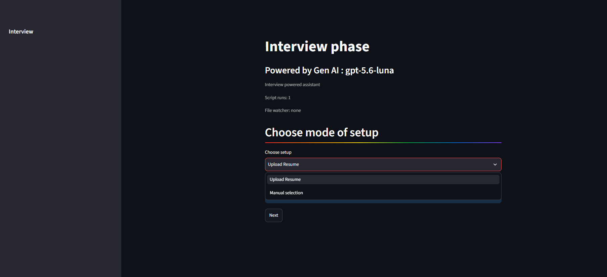
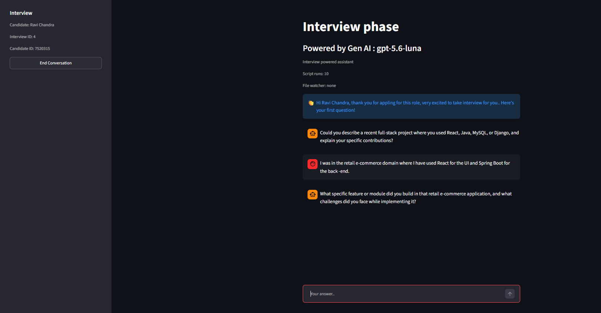
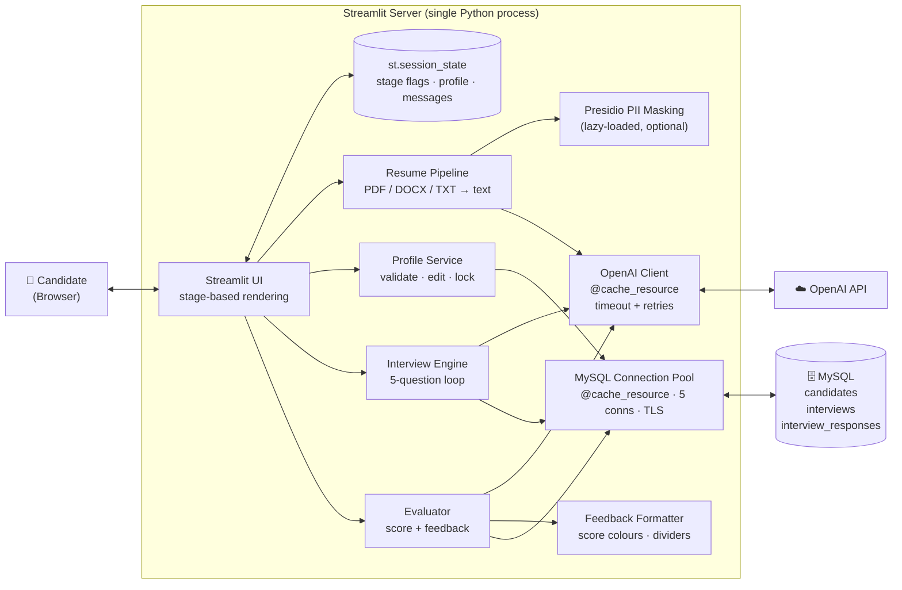
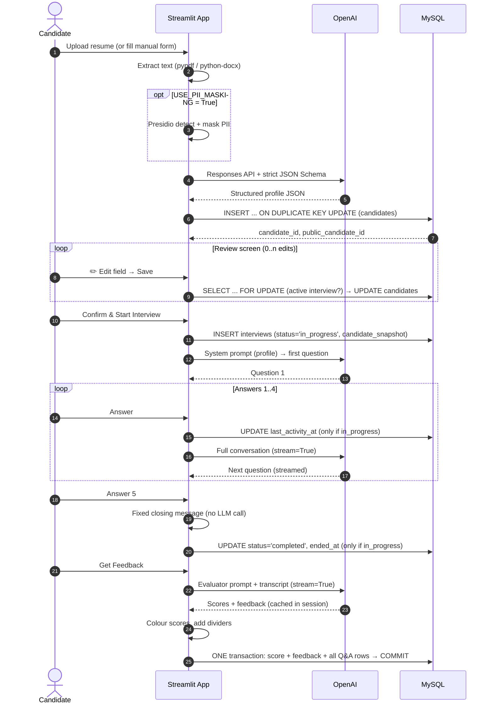
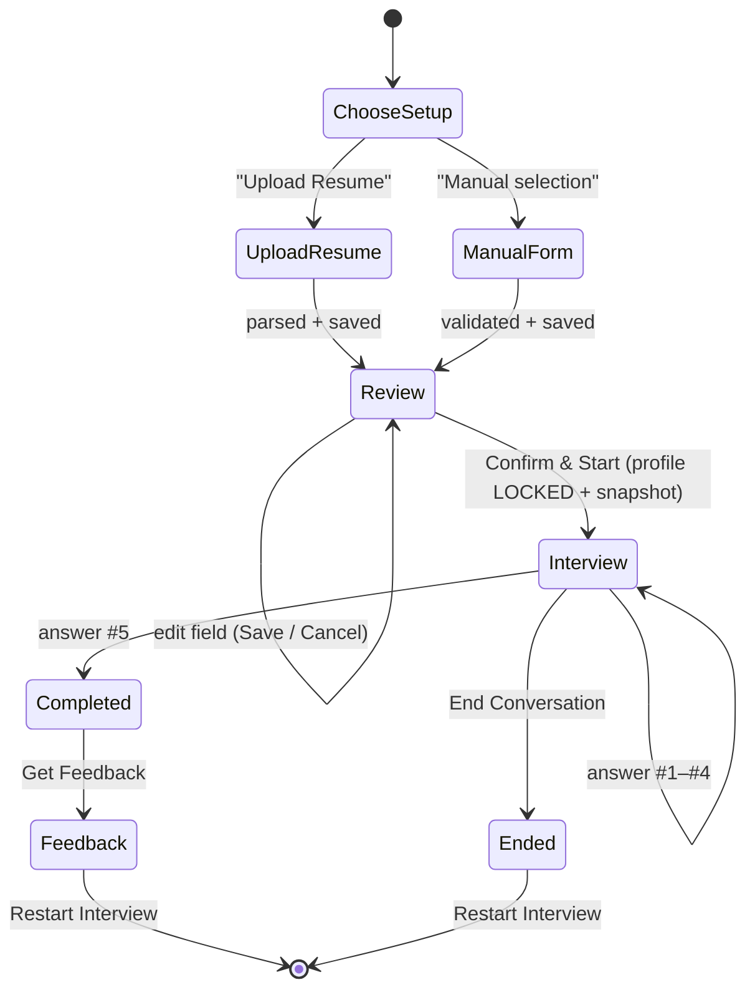
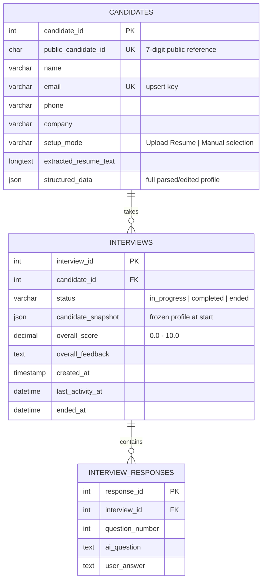
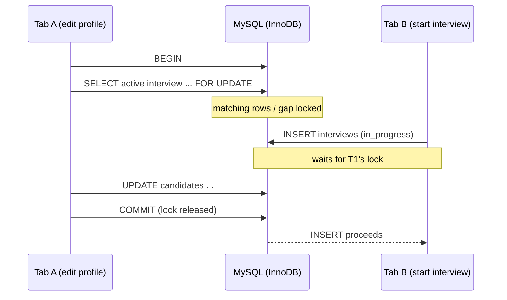

<div align="center">

# 🤖 Ibot — AI Interview Assistant

**An LLM-powered mock-interview platform that reads a candidate's resume, conducts a personalised 5-question technical interview, and produces a scored, question-by-question evaluation — with every step persisted to MySQL.**


</div>

---

<a id="table-of-contents"></a>
## 📑 Table of Contents

1. [Overview](#overview)
2. [Demo](#demo)
3. [Key Features](#key-features)
4. [Tech Stack](#tech-stack)
5. [System Architecture](#system-architecture)
6. [End-to-End Flow](#end-to-end-flow)
7. [Application State Machine](#application-state-machine)
8. [Database Design](#database-design)
9. [Concurrency, Locking & Data Integrity](#concurrency-locking--data-integrity)
10. [Fallbacks & Error Handling](#fallbacks--error-handling)
11. [Performance Optimisations](#performance-optimisations)
12. [Evaluation & Quality Metrics](#evaluation--quality-metrics)
13. [LLM & Prompt Engineering](#llm--prompt-engineering)
14. [Security & Privacy](#security--privacy)
15. [Project Structure](#project-structure)
16. [Getting Started](#getting-started)
17. [Deployment](#deployment)
18. [Design Decisions & Trade-offs](#design-decisions--trade-offs)
19. [Known Limitations & Roadmap](#known-limitations--roadmap)

---

<a id="overview"></a>
## 🧭 Overview

Ibot simulates a real first-round technical interview:

| Stage | What happens |
|---|---|
| **1. Profile** | The candidate uploads a resume (PDF / DOCX / TXT) **or** fills in a manual form. The resume is parsed by an LLM into a strict JSON profile. |
| **2. Review** | The candidate reviews every field (name, email, phone, experience, skills, projects, plus a summary for resumes) and can edit any of them. Edits are written to MySQL. |
| **3. Interview** | On *Confirm & Start*, the profile is **locked** and **snapshotted**. The AI asks **exactly 5** personalised questions, one at a time, with follow-ups based on previous answers. |
| **4. Evaluation** | An evaluator LLM scores each answer (0–5) and computes an overall score (0–10) calibrated to the candidate's years of experience. Scores are colour-coded, and every Q&A pair is saved. |

**The problem it solves:** candidates rarely get realistic, personalised interview practice with structured, honest feedback. Recruiters rarely get a consistent, auditable first-round screen.

---

<a id="demo"></a>
## 🎬 Demo

| Setup | Review your details |
|---|---|
|  |  |

| Interview | Feedback |
|---|---|
|  |  |

---

<a id="key-features"></a>
## ✨ Key Features

- 📄 **Multi-format resume ingestion**: PDF, DOCX and TXT.
- 🧠 **LLM resume parsing with Structured Outputs**: a strict JSON Schema guarantees a well-formed profile, with no fragile string parsing.
- ✏️ **Editable review screen**: per-field ✏️ edit with Save/Cancel, server-side validation and an immediate database update.
- 🔒 **Profile locking and snapshotting**: the profile cannot change once the interview starts, and each interview stores a frozen copy of the profile it was based on.
- 💬 **Adaptive 5-question interview**: questions are generated from the candidate's real experience and stream token-by-token.
- 🛑 **Hard question cap enforced in code, not by the prompt**: the 5th answer ends the interview deterministically, with no 6th LLM call.
- 📊 **Experience-calibrated scoring**: per-question 0–5 scores, a formula-based overall 0–10 score, and colour thresholds applied deterministically in Python.
- 🗄️ **Full audit trail in MySQL**: candidate, interview lifecycle (`in_progress → completed / ended`), score, feedback and every question/answer pair.
- 🛡️ **Optional PII masking** with Microsoft Presidio (lazy-loaded).
- ⚡ **Performance-tuned**: cached clients, connection pooling, lazy heavy imports, feedback caching and streaming.

---

<a id="tech-stack"></a>
## 🧰 Tech Stack

| Layer | Technology | Why |
|---|---|---|
| UI / App server | **Streamlit** | Fast to build interactive data/AI apps in pure Python; built-in chat components and streaming. |
| LLM | **OpenAI** (`gpt-5.6-luna`), Responses API + Chat Completions API | Structured Outputs for parsing; streaming chat for the interview. |
| Database | **MySQL 8** + `mysql-connector-python` (connection pool) | Relational integrity, transactions, row-level locks, JSON columns. |
| Hosting | **Streamlit Community Cloud** + **Aiven** MySQL (free tiers) | Free deployment from GitHub, with a managed database over TLS. |
| Document parsing | `pypdf`, `python-docx` | Lightweight text extraction. |
| PII | **Microsoft Presidio** + spaCy `en_core_web_sm` | Detects and masks names, emails and phone numbers before LLM calls (optional). |
| Browser helper | `streamlit-js-eval` | Page reload for "Restart Interview". |

---
<a id="system-architecture"></a>
## 🏗️ System Architecture



**Key architectural points**

- **Stateless script, stateful session.** Streamlit re-runs the whole script on every interaction. All progress lives in `st.session_state`, and the UI renders the screen that matches the current stage flags (see the [state machine](#application-state-machine)).
- **Process-wide shared resources.** The OpenAI client, the MySQL pool and the Presidio engines are created **once per server process** with `@st.cache_resource` and shared by all users.
- **Database as the source of truth.** Session state drives the UI, but every important transition (profile saved, interview started, completed or ended, results saved) is persisted and guarded in MySQL.

---

<a id="end-to-end-flow"></a>
## 🔄 End-to-End Flow



---

<a id="application-state-machine"></a>
## 🚦 Application State Machine

The UI is a finite-state machine driven by `st.session_state` flags. Only one screen is ever active.



| Flag | Meaning |
|---|---|
| `choose_setup` / `setup_mode` | Setup screen passed; which path was chosen |
| `candidate_profile_saved` / `manual_profile_saved` | Profile persisted → show review screen |
| `setup_complete` | Interview started → profile locked |
| `user_message_count` | Answers submitted (cap = 5) |
| `chat_complete` / `interview_ended` | Interview finished; chat input removed |
| `feedback_shown` / `feedback_text` | Feedback requested / cached result |
| `interview_saved` | Results persisted → never saved twice |

---

<a id="database-design"></a>
## 🗄️ Database Design



The exact table definitions are in [`database/schema.sql`](database/schema.sql).

**Why two IDs?** `candidate_id` is the internal auto-increment key and is never shown. `public_candidate_id` is a random 7-digit reference shown to the candidate, so internal row counts and sequential IDs are not exposed.

---

<a id="concurrency-locking--data-integrity"></a>
## 🔐 Concurrency, Locking & Data Integrity

This section usually gets the most interest in interviews, because it shows that the app is safe beyond the happy path.

### 1. Two-layer profile lock (UI + database)

| Layer | Mechanism | Protects against |
|---|---|---|
| **UI** | Edit controls exist only on the review screen; `save_edit` rejects any save once `setup_complete` is `True`. | Normal users editing after the start. |
| **Database** | `update_candidate_profile` runs, **in the same transaction** as the update: `SELECT ... FROM interviews WHERE candidate_id = ? AND status = 'in_progress' AND ended_at IS NULL AND last_activity_at > NOW() - INTERVAL 2 HOUR FOR UPDATE`. If an active interview exists, the edit is **rejected**. | Stale browser tabs, double clicks and race conditions (UI checks alone are never trusted). |



> The **2-hour activity window** prevents a candidate from being locked out forever by an abandoned interview (a closed tab that never reached `ended`).

### 2. Profile snapshot (audit integrity)

When the interview starts, the full profile is copied into `interviews.candidate_snapshot` (JSON). Even if the candidate later returns and edits their profile for a **new** interview, every past score stays tied to the exact profile it was evaluated against.

### 3. Idempotent, guarded state transitions

Every lifecycle update includes its precondition in the `WHERE` clause, so it can only happen once and only from a valid state:

```sql
UPDATE interviews
SET status = 'completed', ended_at = CURRENT_TIMESTAMP(6)
WHERE interview_id = ? AND status = 'in_progress' AND ended_at IS NULL;
```

- An interview **cannot be ended twice**, and `ended` and `completed` cannot overwrite each other.
- `update_interview_activity` fails (`rowcount = 0`) if the interview is no longer active, so **answers to a closed interview are rejected**.
- `ended_at = COALESCE(ended_at, CURRENT_TIMESTAMP(6))` keeps the original end time when results are saved later.

### 4. Exactly-once semantics in the app layer

| Operation | Guard |
|---|---|
| Interview row creation | Created only when `interview_id is None` → one row per session. |
| Resume processing | SHA-256 hash of the file → the same file is never re-parsed or re-saved on rerun. |
| Feedback generation | Cached in `feedback_text` → one LLM call per interview. |
| Result persistence | `interview_saved` flag → results written once. |

### 5. Atomic result save

Score, feedback and all Q&A rows are written in **one transaction**. Any failure (for example, the score can't be parsed) triggers a `ROLLBACK`, so the database never holds a half-saved interview. Because feedback is cached, the save can be retried on the next rerun **without another LLM call**.

### 6. Upsert with stable IDs

```sql
INSERT INTO candidates (...) VALUES (...)
ON DUPLICATE KEY UPDATE candidate_id = LAST_INSERT_ID(candidate_id), ...
```

A returning candidate (same email) reuses their row. The `LAST_INSERT_ID(candidate_id)` trick makes `cursor.lastrowid` return the **existing** ID, and `public_candidate_id` is never overwritten.

### 7. SQL injection safety

Every query uses **parameterised placeholders** (`%s`). No user input is ever concatenated into SQL.

---

<a id="fallbacks--error-handling"></a>
## 🛟 Fallbacks & Error Handling

| Failure | Behaviour |
|---|---|
| OpenAI key missing or empty | A clear configuration error is shown and the app stops. The key is never logged. |
| Transient OpenAI/network errors | Client configured with `timeout=90s` and `max_retries=2`. |
| Scanned / empty resume | Rejected early: *"No readable text was found..."* |
| Unsupported file type | Blocked by the uploader (`pdf/docx/txt`) and validated again in code. |
| LLM returns malformed data | Prevented by **strict JSON Schema**; fields are then normalised (trimmed strings, `None` for blanks, lists guaranteed). |
| Ambiguous candidate name | The parser is instructed to return `null` instead of guessing (for example, not "Django"). |
| No summary produced | A fallback summary text is stored. |
| First question fails | Nothing is saved to the session, so the call is retried on the next rerun. |
| Next question fails | The answer is undone so the candidate can send it again. |
| Second answer sent while a question streams | Blocked: the chat input is locked until the reply finishes. |
| Idle / dropped MySQL connection | `conn.ping(reconnect=True, attempts=2)` before every use; a failed connection is still returned to the pool. |
| Database unavailable during resume save | The candidate sees *"the database is unavailable. Please try again shortly."* instead of a resume error. |
| Any DB error | `ROLLBACK`, connection returned to the pool, user-friendly message, error details in the server log only. |
| Duplicate email on edit | `IntegrityError` caught → *"This email is already linked to another candidate."* |
| Invalid edits | Validated before saving (required name, email format, phone format, numeric experience). |
| Starting with unsaved edits | *Confirm & Start* is disabled while any edit box is open. |
| Interview ended early | No feedback is generated; the candidate is told why and offered **Restart Interview**. |
| LLM tries to ask a 6th question | Impossible, because the 5th answer ends the interview **in code** without calling the LLM. |
| Score missing from feedback | A tolerant regex handles Markdown and colour wrappers; if it still fails, nothing is saved (rollback) and a friendly error is shown. |
| Wrong colour from the LLM | Impossible, because colours are applied **in Python** from fixed thresholds, not by the model. |

---

<a id="performance-optimisations"></a>
## ⚡ Performance Optimisations

Every expensive operation is wrapped in a `measure_time()` context manager that logs `[PERFORMANCE] <operation>: <seconds>`, so each optimisation below was measured, not guessed.

| # | Bottleneck | Optimisation | Impact |
|---|---|---|---|
| 1 | Presidio loaded spaCy `en_core_web_lg` (~550 MB) on **every app start**, even when unused | **Lazy import** inside a cached factory, switched to `en_core_web_sm` (~12 MB), and loaded only when `USE_PII_MASKING = True` | Removes the largest startup delay |
| 2 | Feedback **regenerated on every rerun** (any click → new 3,000-token LLM call; score changed each time) | Cached in `st.session_state.feedback_text` | 1 evaluation call per interview; stable scores; lower cost |
| 3 | New MySQL TCP + auth handshake for **every query** (including every answer) | `MySQLConnectionPool` (5 conns) cached with `@st.cache_resource` | DB calls drop from a full connect to an in-memory checkout |
| 4 | New `OpenAI()` client on every rerun | Cached client → reused HTTP connection pool | Fewer TLS handshakes |
| 5 | Long waits for LLM output | **Streaming** (`stream=True` + `st.write_stream`) for questions and feedback | Text appears as it is generated instead of all at once |
| 6 | Over-thinking on simple tasks | Reasoning effort tuned per task: `none` for questions, `low` for parsing and evaluation | Lower latency and cost |
| 7 | Re-parsing the same resume on rerun | SHA-256 file hash check | Parse once per file |
| 8 | Streamlit file watcher overhead | `.streamlit/config.toml`: `fileWatcherType = "none"` (prod), `fastReruns = true`, telemetry off | Less background work |

<!-- Tip: replace "Impact" with your own numbers from the [PERFORMANCE] logs, e.g. "Startup 14.2 s → 1.8 s". Real numbers are very persuasive in interviews. -->

---

<a id="evaluation--quality-metrics"></a>
## 📏 Evaluation & Quality Metrics

An LLM app is only as good as you can prove it is. [`evaluate.py`](evaluate.py) measures the bot with **16 metrics**. It runs **outside** Streamlit, only **reads** what the app already stores (MySQL and the `[PERFORMANCE]` log), and never changes the app or its data. **13 of the 16 metrics cost nothing**: they're plain Python over stored data, with no LLM calls.

| # | Metric | What it catches | Cost |
|---|---|---|---|
| **1** | **Formula adherence** | The overall score doesn't match `Σ question scores / (n × 5) × 10`, meaning the model *invented* it | Free |
| **2** | **Format compliance** | Missing overall score (breaks saving), legend, question blocks or fields | Free |
| **3** | **Zero-for-skip** | Points given for skipped / "I don't know" answers | Free |
| **4** | **Answer-summary grounding** | A *"Candidate Answer"* summary that describes things the candidate never said | Free |
| **5** | **One-question rule** | More than one question per turn | Free |
| **6** | **Personalisation rate** | Generic questions that use nothing from the candidate's profile | Free |
| **7** | **Repeated questions** | The same question asked twice in one interview | Free |
| **8** | **Question length** | Rambling, multi-part questions | Free |
| **9** | **Resume "not invented"** | Parsed email / phone / company / name that don't appear in the resume text | Free |
| **10** | **Resume field accuracy** | Name/email/phone accuracy, experience error, skills precision / recall / F1 against hand-checked labels | Free |
| **11** | **System metrics** | Completion rate, interview duration, score distribution | Free |
| **12** | **Latency per step** | p50 / p95 / max seconds for parsing, questions, feedback, reruns | Free |
| **13** | **Failure counts** | Score not extracted, save failed, OpenAI errors, tracebacks | Free |
| **14** | **Golden-set ranking** | 4 synthetic interviews of known quality must score *skipped < weak < decent < excellent*, and *skipped* exactly 0 | ~4 calls |
| **15** | **Scoring consistency** | The same interview scored 3× gives different results (standard deviation) | ~2 calls |
| **16** | **Experience calibration** | The same answers aren't judged differently for 1 vs 8 years of experience | ~2 calls |

**Cost control for the paid tests (14–16):**
- The evaluator prompt and model are **read from `interview_app.py`** itself, so the tests always match the live app.
- A **plan** with the number of calls and a token estimate is printed, and nothing is sent until you type `yes`.
- A hard **`--max-calls`** limit (default 10) applies.
- Every answer is **cached** in `eval/cache/`, so running the tests again costs $0.
- The tests use **synthetic interviews only** ([`eval/golden_transcripts.json`](eval/golden_transcripts.json)), so no real candidate data is sent.

**Run it**

```bash
python evaluate.py --sample          # demo interview with planted mistakes (no DB, no API)
python evaluate.py                   # free metrics on your real interviews
python evaluate.py --perf-log perf.log --resume-labels eval/resume_labels.json
python evaluate.py --llm-tests       # paid tests: shows the plan, asks before calling
```

**Example output** (`--sample`, whose demo interview has deliberate errors):

```
1  Formula adherence rate (%)                0.0
2  Format compliance rate (%)                100.0
3  Zero-for-skip rate (%)                    0.0
4  Summary grounding (avg 0-1)               0.75
5  One-question rule (%)                     80.0
6  Personalisation rate (%)                  80.0
7  Repeated question pairs                   1

  Interview SAMPLE:
    - formula: reported 7.0 vs expected 5.4
    - Q3 skipped but scored 1.0/5
    - Q4 summary grounding 0.0
    - multiple questions in Q[4]
    - Q1 and Q5 repeat (similarity 0.96)
```

**What it found on real data:** the evaluator followed its rules (formula adherence 100 %, all skipped answers scored 0), but only **20 %** of the questions used the candidate's profile. That points to the interviewer prompt as the next thing to improve, and gives a number to measure the improvement against. This was based on the first interview stored, so the rates become meaningful as more interviews are completed.

Reports print interview IDs and numbers only (no names, emails or answers) and are saved to `eval/results/metrics_<time>.json` (git-ignored) for before/after comparisons.

---

<a id="llm--prompt-engineering"></a>
## 🧠 LLM & Prompt Engineering

| Call | API | Reasoning | Streaming | Output control |
|---|---|---|---|---|
| Resume parsing | Responses API | `low` | No | **Strict JSON Schema** (Structured Outputs) |
| First question | Chat Completions | `none` | No | `max_completion_tokens=400` |
| Follow-up questions | Chat Completions | `none` | Yes | Full conversation history as context |
| Evaluation | Chat Completions | `low` | Yes | Strict Markdown template + scoring formula |

**Prompt-design principles used**

- **Grounding:** the interviewer prompt contains the confirmed profile and is told *"Do not invent candidate experience or skills."*
- **One question at a time**, with follow-ups based on the candidate's actual answers.
- **Formula-based scoring** stops the model from "inventing" an overall score: `Overall = (Σ question scores / (n × 5)) × 10`, rounded to 1 decimal place.
- **Experience calibration:** expectations scale with the candidate's years of experience.
- **Anti-hallucination rules:** never fabricate questions, answers or technical details; a missing answer is scored as missing.
- **Deterministic post-processing:** **code**, not the model, owns the business rules (question cap, colour thresholds, dividers, score extraction). The LLM produces content; Python enforces rules.

**Colour thresholds (applied in Python)**

| Ratio | Per question (/5) | Overall (/10) | Colour |
|---|---|---|---|
| < 60 % | < 3.0 | < 6.0 | 🔴 Red: Poor |
| 60 – < 90 % | 3.0 – 4.4 | 6.0 – 8.9 | 🟠 Yellow: Average |
| ≥ 90 % | ≥ 4.5 | ≥ 9.0 | 🟢 Green: Good |

---

<a id="security--privacy"></a>
## 🛡️ Security & Privacy

- **Secrets** (OpenAI key, DB credentials) live in `.streamlit/secrets.toml` locally, which is **git-ignored**, and in Streamlit Cloud's encrypted secrets when deployed. They are never logged.
- **Encrypted database connection:** the cloud database uses TLS with certificate verification (`certs/ca.pem`, a public CA certificate).
- **Least-privilege database user:** the app account can only read and write this app's tables.
- **Parameterised SQL** everywhere.
- **Optional PII masking** (Presidio) before text is sent to the LLM, with custom recognisers for company names.
- **Public vs internal candidate IDs:** the internal `candidate_id` is never shown.
- **Server-side validation** of every edited field; database-level locks rather than UI-only checks.
- **Upload limit:** resumes are limited to 5 MB (`server.maxUploadSize`).
- **Metadata-only logging:** logs hold IDs, timings, the file-hash prefix and error types, never resume text or contact details.

---

<a id="project-structure"></a>
## 📁 Project Structure

```
Interview-Gen-AI-BOT/
├── interview_app.py          # Streamlit application (all sections numbered & commented)
├── evaluate.py               # 16 quality metrics (runs outside Streamlit, read-only)
├── AI_Interview_icon.png     # Browser tab icon
├── requirements.txt
├── README.md
├── .gitignore
├── certs/
│   └── ca.pem                # Public CA certificate for the cloud database
├── database/
│   └── schema.sql            # Table structure (no data)
├── docs/                     # Screenshots for this README
├── eval/
│   ├── golden_transcripts.json     # Synthetic interviews of known quality (paid tests)
│   └── resume_labels.example.json  # Template for hand-checked resume fields
└── .streamlit/
    ├── config.toml           # Server/runtime settings (committed)
    └── secrets.toml          # API key + DB credentials (NOT committed)
```

**Code map (sections in `interview_app.py`)**

| Section | Responsibility |
|---|---|
| 1–4 | Imports, performance timer, page config, rerun diagnostics |
| 5 / 5.1 | Cached OpenAI client · cached MySQL connection pool |
| 6–10 | Session-state initialisation, callbacks, setup screen |
| 11–13 | Resume text extraction · JSON schema · LLM parsing |
| 14–15 | Lazy Presidio PII engine · masking |
| 16 / 16.1 / 16.2 | Candidate upsert · profile edit helpers + DB lock · review screen |
| 17 / 18 | Upload-resume path · manual-form path |
| 18.16–18.18 | Interview lifecycle DB functions · sidebar |
| 19–21 | Interview chat loop · completion · *Get Feedback* |
| 22 / 22.7 / 22.8 | Transactional result save · score colouring · evaluator prompt |
| 23–24 | Feedback rendering + persistence · run timing |

---

<a id="getting-started"></a>
## 🚀 Getting Started

<details>
<summary><b>Run it locally (5 steps)</b></summary>

**Prerequisites:** Python 3.10+, MySQL 8.x, an OpenAI API key.

```bash
# 1. Clone and install
git clone https://github.com/naveenvasu55/Interview-Gen-AI-BOT.git
cd Interview-Gen-AI-BOT
pip install -r requirements.txt
```

**2. Create the database:** create an empty database named `interview_db`, then run [`database/schema.sql`](database/schema.sql) in it, for example with MySQL Workbench.

**3. Add secrets** in `.streamlit/secrets.toml` (git-ignored):

```toml
OPENAI_API_KEY = "sk-..."

[mysql]
host = "localhost"
port = 3306
user = "ibot_user"
password = "********"
database = "interview_db"
```

```bash
# 4. Run (only this computer can open it)
streamlit run interview_app.py --server.address 127.0.0.1
```

**5. (Optional) PII masking:** set `USE_PII_MASKING = True`, pass `masked_resume_text` to the parser (Section 17), and install the extra packages:

```bash
pip install presidio-analyzer presidio-anonymizer
python -m spacy download en_core_web_sm
```

</details>

---

<a id="deployment"></a>
## ☁️ Deployment

The app runs for free on **Streamlit Community Cloud** with a free **Aiven** MySQL database.

1. **Create the database:** in the Aiven MySQL service, create an `interview_bot` database and a dedicated app user with `SELECT, INSERT, UPDATE, DELETE` on that database only, and `REQUIRE SSL`.
2. **Load the tables:** run [`database/schema.sql`](database/schema.sql) in `interview_bot`.
3. **Add the certificate:** commit Aiven's CA certificate as `certs/ca.pem`. It's public, so it's safe in the repository.
4. **Deploy:** on [share.streamlit.io](https://share.streamlit.io), choose this repository and `interview_app.py` as the main file.
5. **Add the secrets** under **Advanced settings**:

```toml
OPENAI_API_KEY = "sk-..."

[mysql]
host = "<aiven-host>"
port = 12345
user = "<app-user>"
password = "<app-password>"
database = "interview_bot"
ssl_ca = "certs/ca.pem"
ssl_verify_cert = true
```

> Free tiers switch off when idle: Streamlit apps sleep and Aiven services power off, so both may need waking before use.

---

<a id="design-decisions--trade-offs"></a>
## ⚖️ Design Decisions & Trade-offs

Important concepts, with the reasoning behind each choice.

<details>
<summary><b>Why lock the profile at interview <i>start</i> instead of at the end?</b></summary>

The AI generates its questions **from** the profile. If the profile could change mid-interview, questions, answers and the score would refer to different data. Production assessment platforms work the same way: review and confirm first, then lock.
</details>

<details>
<summary><b>Why store a snapshot when the profile is already in <code>candidates</code>?</b></summary>

`candidates` is **mutable** and reused across interviews (upsert by email). The snapshot makes every interview **immutable and auditable**: you can always explain a score using the exact data the AI saw.
</details>

<details>
<summary><b>Why enforce the lock in the database if the UI already hides the buttons?</b></summary>

UI state can be stale (two tabs, double clicks, slow reruns). Only the database sees every request in order. `SELECT ... FOR UPDATE` inside the same transaction makes the check-then-update **atomic**.
</details>

<details>
<summary><b>Why apply score colours in Python instead of asking the LLM?</b></summary>

LLMs follow formatting rules *most* of the time. Business rules (thresholds, caps, layout) must be **100% deterministic**, so the model outputs plain numbers and code applies the rules. This also keeps the stored feedback clean (no colour markup in the database).
</details>

<details>
<summary><b>Why end the interview in code at answer 5 instead of telling the LLM "ask 5 questions"?</b></summary>

Prompt-only limits are not guaranteed. A counter in session state makes the cap exact, and skipping the final LLM call saves latency and cost.
</details>

<details>
<summary><b>Why a connection pool in a Streamlit app?</b></summary>

Streamlit reruns the script constantly, and the app writes to MySQL on every answer. Re-connecting each time adds a TCP + auth round-trip per action. A cached pool shared across sessions removes that cost; `ping(reconnect=True)` handles idle timeouts.
</details>

<details>
<summary><b>Why Structured Outputs (JSON Schema) for resume parsing?</b></summary>

Free-text JSON from an LLM can be malformed or missing keys. Strict schema mode guarantees valid JSON with exactly the required fields, which removes a whole class of parsing bugs.
</details>

<details>
<summary><b>Why Streamlit instead of React + FastAPI?</b></summary>

For an AI prototype, Streamlit gives chat UI, streaming and state management in pure Python, which keeps the focus on the LLM and data logic. The trade-off (single process, rerun model, limited UI control) is acceptable at this stage and is addressed in the roadmap.
</details>

---

<a id="known-limitations--roadmap"></a>
## 🧩 Known Limitations & Roadmap

Being upfront about limitations is a strength in interviews.

| Area | Current state | Planned improvement |
|---|---|---|
| Code organisation | Single-file Streamlit app | Split into `services/` (llm, db, resume, scoring) and `ui/` modules |
| Testing | Manual testing + [`evaluate.py`](#evaluation--quality-metrics) quality metrics | `pytest` unit tests for validators, score regex, colouring and DB functions (with a test DB) |
| Evaluation coverage | Token cost per interview, review-screen edit rate and per-question drop-off aren't logged yet | Log token usage and parsed-vs-edited fields to add these metrics |
| Feedback format | Score extracted from Markdown via regex | Use Structured Outputs for evaluation (JSON scores + text) → no regex dependency |
| Stale interviews | Ignored after 2 h by the lock query | Scheduled job to mark abandoned `in_progress` interviews as `ended` |
| Logging | Plain `print` output in the server log | Structured logging with log levels |
| Authentication | None (identity = email), so the same email overwrites a profile | Login / magic link; role-based recruiter dashboard |
| Availability | Free tiers sleep when idle and need waking | Always-on hosting and a serverless or paid database |
| Scale | Single Streamlit process | Containerise (Docker), externalise state, move LLM/DB work behind an API |
| Analytics | Raw data in MySQL | Recruiter dashboard: score distributions, skill gaps, question difficulty |
| Interview modes | Text only | Voice interviews (speech-to-text), role-specific question banks, coding questions |

---

<a id="how-to-present-this-project-cheat-sheet"></a>
## 🎤 How to Present This Project (cheat sheet)

1. **Problem (30 s):** realistic, personalised interview practice with honest, structured feedback.
2. **Live demo (2 min):** upload a resume → edit a field on the review screen → answer 2–3 questions → show colour-coded feedback → show the rows in MySQL.
3. **Architecture (1 min):** walk through the [architecture diagram](#system-architecture) and the [state machine](#application-state-machine).
4. **Hardest problems solved (2 min):**
   - Race-safe profile locking with `SELECT ... FOR UPDATE` + a 2-hour stale window.
   - Exactly-once semantics in a framework that reruns the whole script on every click.
   - Moving business rules out of the LLM into deterministic code.
5. **Performance story (1 min):** "I instrumented every step, found the 550 MB spaCy model loading on startup, and fixed it with lazy loading" plus pooling and caching.
6. **Evaluation story (1 min):** "I measure the bot with 16 metrics, 13 of them free. They proved the scores follow the formula, and showed that only 20 % of the questions were personalised, which is the next thing to fix." Run `python evaluate.py --sample` live.
7. **What I'd do next (30 s):** modularise, add tests, Structured Outputs for evaluation, Docker.

---
